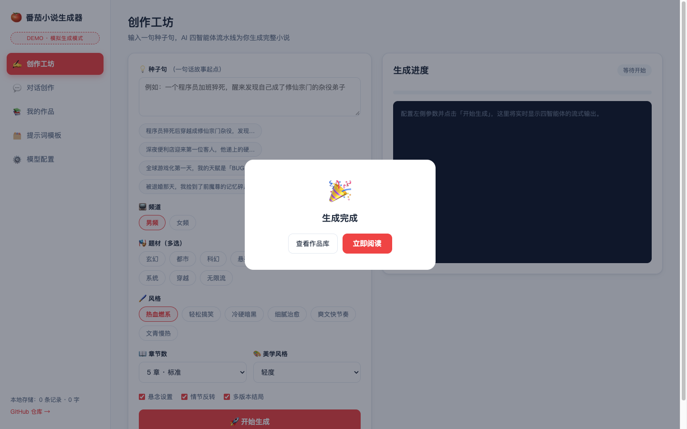
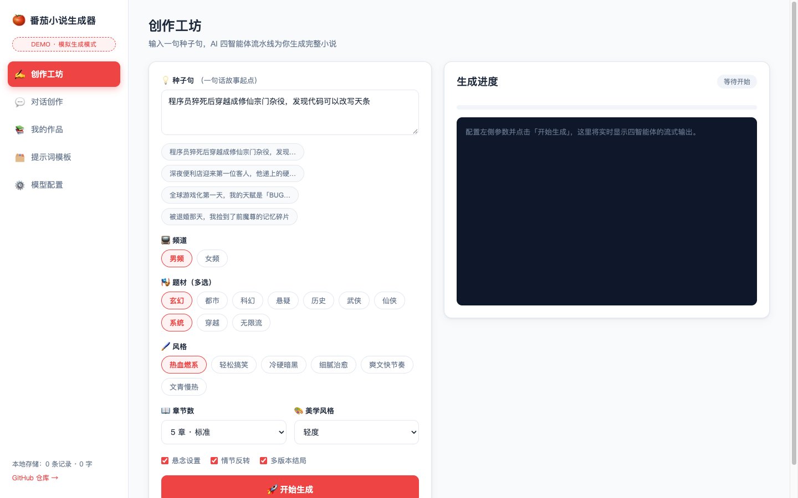
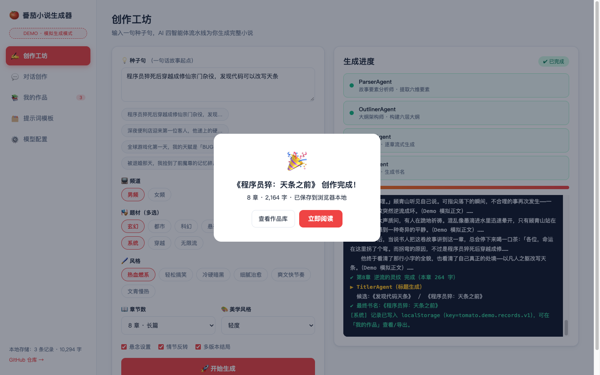
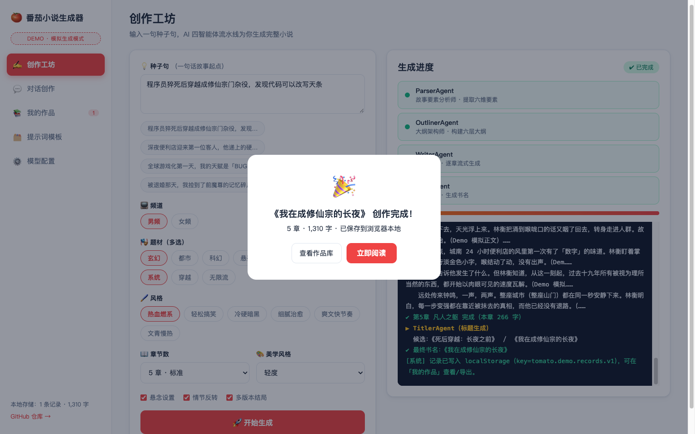
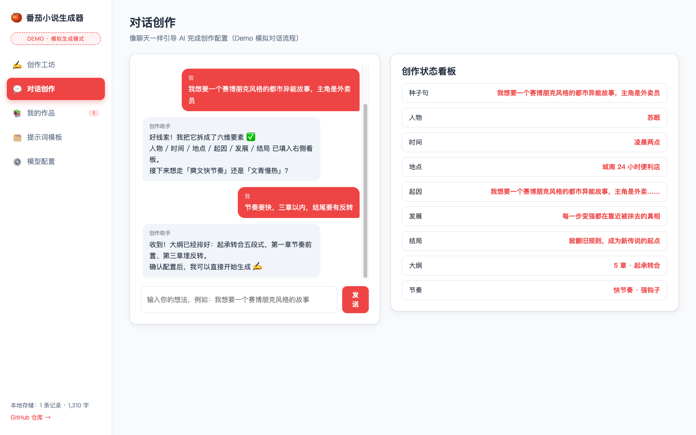
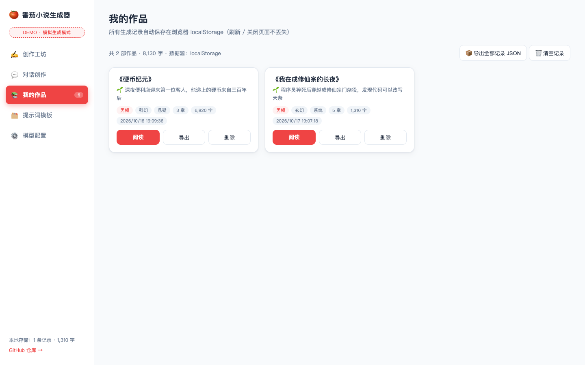
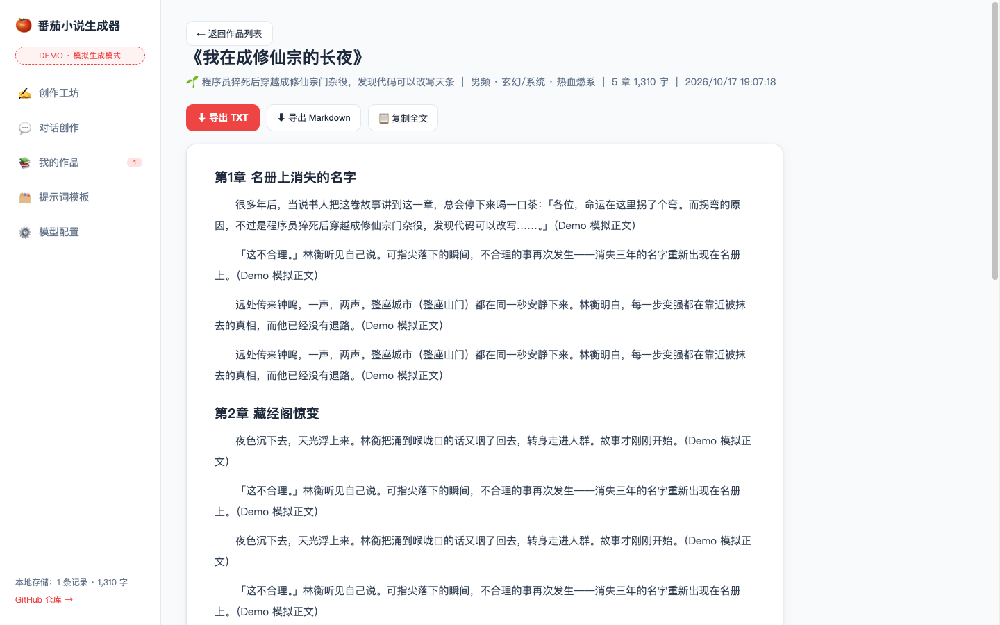
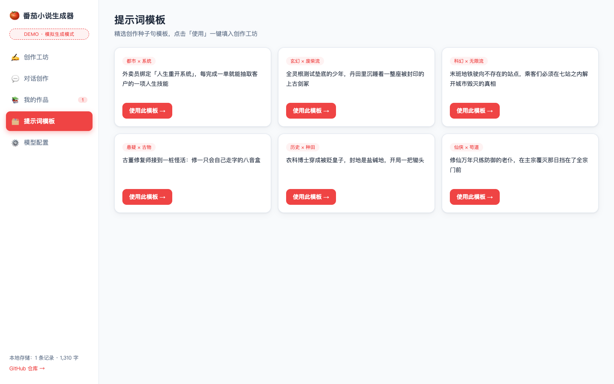
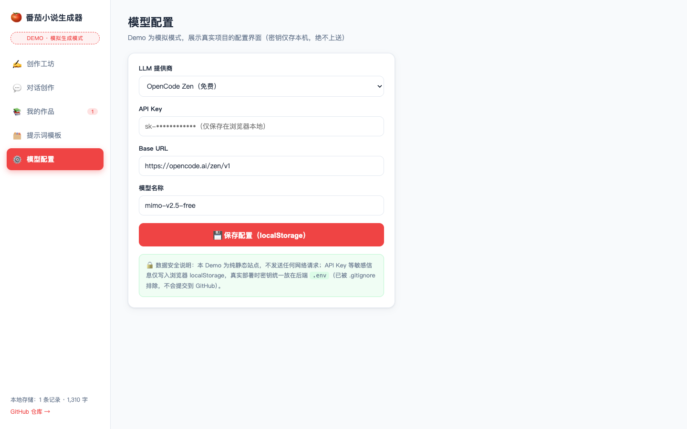

# 🍅 Tomato Novel Generator — AI-driven Novel Creation System

**中文** | [English](README.en.md)

> **One sentence in, a complete novel out.**
> Updated: 2026-10-18 · Latest: v3.1.1

[](https://snow-sakura.github.io/novel-generator/)
[](https://opensource.org/licenses/MIT)
[](https://github.com/snow-sakura/novel-generator/actions/workflows/security-scan.yml)
[](https://github.com/snow-sakura/novel-generator/actions/workflows/e2e.yml)
[](https://github.com/snow-sakura/novel-generator/actions/workflows/e2e-v1.yml)

---

## 🚀 Live Demo — zero install

**👉 https://snow-sakura.github.io/novel-generator/**

A fully GitHub-powered demo: hosted on **GitHub Pages**, published by **GitHub Actions**, all data records (generated novels & settings) persisted in your browser's **localStorage** — nothing is ever uploaded. It faithfully reproduces the V3 workflow with a client-side simulation engine.

## 📖 The 9-step workflow (screenshots captured automatically via Playwright)

| Step | What happens | Screenshot |
|------|--------------|------------|
| 1 · Open the studio | No sign-up. Sidebar: Create / Chat / Library / Templates / Settings |  |
| 2 · Write a seed sentence | Configure channel, genres (multi), style, chapter count, narrative switches |  |
| 3 · Four-agent pipeline | Parser → Outliner → Writer → Titler streams progress live, like watching an assembly line |  |
| 4 · Auto-save | Completion card with title/chapters/word count; record written to localStorage |  |
| 5 · Chat-driven creation | Talk to the assistant instead of filling forms; status board mirrors every decision |  |
| 6 · Library | All records as cards: read / export / delete / **export full JSON data record** |  |
| 7 · Read & export | Chapter typesetting; export TXT / Markdown / copy all |  |
| 8 · Prompt templates | Curated seed sentences by category, one click to apply |  |
| 9 · Model settings | Provider config UI (OpenCode Zen / OpenAI-compatible / DeepSeek / Qwen / AGNES); keys masked & local-only |  |

## 🏗️ Architecture (production stack)

React 18 + TypeScript + Vite + Zustand ⇄ SSE/REST ⇄ FastAPI + LangChain/CrewAI four-agent pipeline + LLM provider factory ⇄ SQLite.
The demo replaces backend & DB with a static simulation engine + localStorage — identical UX.

Details: [docs/ARCHITECTURE.md](docs/ARCHITECTURE.md)

## 🗂️ Sub-projects

| Path | What it is |
|------|-----------|
| `novel-build-system/v1` | Skeleton edition — the minimal working AI content generator (v1.6.1, AGNES support) |
| `novel-build-system/v3` | **Soul edition (recommended)** — full F1-F13 feature set (latest) |
| `demo/` | GitHub Pages demo source (pure static, auto-deployed) |
| `novel-build-test/` | AISQA — a separate AI-driven software-testing platform |

## ⚡ Run locally (full stack)

```bash
# Docker (V1 + V3 in one shot)
cd novel-build-system && docker compose up -d --build
# V3 → http://localhost:3003  |  V1 → http://localhost:3001

# or manually (V3)
cd novel-build-system/v3/backend  && bash run.sh
cd novel-build-system/v3/frontend && npm install && npm run dev
# put your LLM key in backend/.env (git-ignored, never committed)
```

Test it: `cd novel-build-system/v3/frontend && npm run build && npx playwright test` (92 offline E2E cases, mock API, no backend needed).

## 🔐 Security & privacy

- API keys live only in runtime `.env` files / browser localStorage — `.env`, `*.db`, backups are git-ignored and enforced by a **gitleaks CI gate**;
- Backend masks keys in responses, CORS allowlist, 10MB body limit;
- Demo makes **zero** network requests. See [docs/SECURITY.md](docs/SECURITY.md).

## 📚 Docs

[Index](docs/README.md) · [PRD](docs/PRD.md) · [Architecture](docs/ARCHITECTURE.md) · [User guide](docs/USER-GUIDE.md) · [Deployment](docs/DEPLOYMENT.md) · [Security](docs/SECURITY.md) · [Demo](docs/DEMO.md) · [Changelog](CHANGELOG.md)

## License

MIT © 2026 snow-sakura

<p align="center">Made with ❤️ by AI + Human · Demo powered by GitHub Pages</p>
